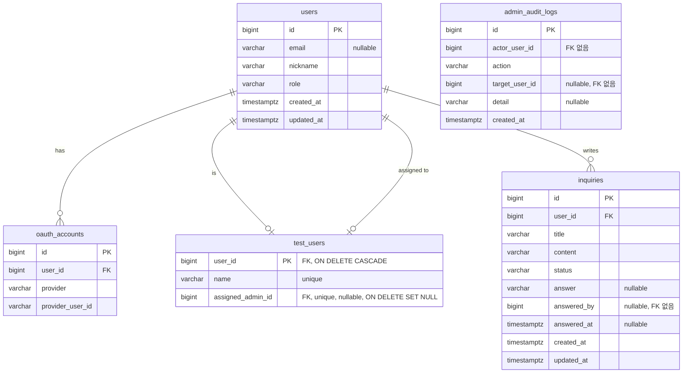

# ERD

> 엔티티 클래스가 진실이다. 이 문서는 시각화와 비즈니스 의미 보조만 담당한다.
> 스키마를 바꿀 때는 **코드 먼저**, 그다음 이 문서를 갱신한다.
> 설계 이유는 여기 쓰지 않는다 (→ [`adr/`](adr/)).

> `admin_audit_logs`는 `users`와 관계선을 갖지 않는다. FK가 없기 때문이며, 그 안의 사용자 식별자는
> 참조가 아니라 **그 시점의 기록**이다.

## 제약

| 테이블 | 제약 | 의미 |
|---|---|---|
| `users` | `role` 값은 `Role` enum (`USER`/`ADMIN`) — DB 제약이 아니라 엔티티가 강제한다 | 한 사람은 한 역할만 갖는다 |
| `users` | `email`·`nickname` 에 UNIQUE 없음 | 이메일은 표시용 속성이고, 닉네임은 동명이인을 허용한다 |
| `users` | `email` 은 NULL 허용 | IdP 가 이메일을 주지 않으면 없다 (신원 없이 만들어진 Test User 도 그렇다). 사용자 검색·식별 키로 쓸 수 없다 |
| `oauth_accounts` | UNIQUE (`provider`, `provider_user_id`) | 같은 Provider 의 같은 사용자는 한 행만 존재한다 |
| `oauth_accounts` | `user_id` → `users.id` | 한 User 는 여러 Provider 신원을 가질 수 있다 (계정 연결 기능은 없어 현재는 1행) |
| `test_users` | `user_id` 가 PK 이며 `users.id` 참조 | 한 User 는 Test User 이거나 아니다. 행의 존재가 곧 Test User 여부다 |
| `test_users` | `user_id` `ON DELETE CASCADE` | 부하 시나리오가 탈퇴를 호출할 수 있다. 이 리포의 다른 FK 와 달리 예외적으로 DB 가 정리한다 |
| `test_users` | `name` UNIQUE | 부하 테스트 스크립트의 참조 키이자 시드 멱등성의 기준. 닉네임은 사용자가 바꿀 수 있어 키가 될 수 없다 |
| `test_users` | `assigned_admin_id` UNIQUE, NULL 허용 | 관리자 1:1 배정을 DB 가 강제한다. NULL 이면 부하 테스트 전용이다 |
| `test_users` | `assigned_admin_id` `ON DELETE SET NULL` | 관리자가 탈퇴하면 배정이 자동 회수된다. 유령 배정이 남으면 그 행을 다시 쓸 수 없다 |
| `inquiries` | `user_id` → `users.id`, CASCADE 없음 | 탈퇴 시 서비스가 명시적으로 지운다. **이 삭제를 빠뜨리면 탈퇴가 FK 위반으로 깨진다** |
| `inquiries` | `status` 값은 `OPEN`/`ANSWERED` — 엔티티가 강제한다 | 문의 하나에 답변 하나. 스레드가 아니다 |
| `inquiries` | `answered_by` 에 FK 없음 | 답변한 관리자가 탈퇴할 수 있다. 참조가 아니라 기록이다 |
| `admin_audit_logs` | `actor_user_id`·`target_user_id` 에 FK 없음 | 탈퇴가 hard delete 라, FK 를 걸면 탈퇴가 실패하거나(RESTRICT) 감사 기록이 함께 사라진다(CASCADE). 감사 로그는 대상이 사라져도 남아야 한다 |
| `admin_audit_logs` | 추가 전용 (수정·삭제 API 없음) | 관리자 권한으로 수행된 행위의 불변 기록 |
| `admin_audit_logs` | `action` 값은 `USER_ROLE_UPDATE`/`SESSION_REVOKE` — DB 제약이 아니라 엔티티가 강제한다 | 대상이 실사용자인 두 행위만 남긴다. 샌드박스 진입은 기록하지 않는다 ([ADR-0003](adr/0003-test-support-isolation.md) 8번) |

> 동일인 판정은 (`provider`, `provider_user_id`) 로만 한다. 용어 정의는 [`CONTEXT.md`](CONTEXT.md).
