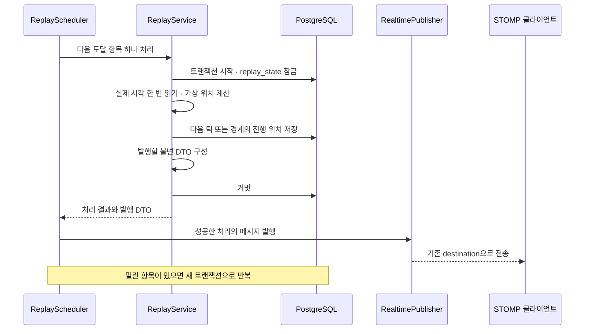

# 재생 스케줄러와 WS 연결

상태: 구현됨 (`S15P21A605-53~57`). 아래 순서와 메시지 표는 실제 코드와 테스트가 지키는 계약이다.
관리자 화면은 Spring 으로 이관했고, 일반 마켓 화면의 REST·WS 는 아직 목이다.

후속 범위 확정: 기존 관리자 재생 화면의 Spring 부분 이관과 테스트 실제 시작 시각 예약은 [최신 스펙](../../../docs/specs/market-replay-clock-scheduler.md)을 따른다. 아래 프론트 접점 설명은 현재 구현 조사 결과이며 이번 관리자 화면 수정을 제외한다는 뜻이 아니다.

이번 범위는 V13 재생 시계, 틱 공개 기준, 시간 경계 진행, 정지·재개·배속 변경과 WS 발행이다.
예약 체결·IPO·평가·정산 업무, seek·계좌 초기화, 실제 가격 전체 적재는 제외한다.

## 현재 연결 지점

- `global/config/WebSocketConfig`: `/ws`, STOMP simple broker, 세션 인증, `app.base-url` 출처 제한, 10초 하트비트.
- `global/websocket/RealtimePublisher`: 공통 봉투를 만들고 즉시 전송한다. 트랜잭션 완료를 확인하지 않는다.
- `WsDestination`: `/topic/tick`, `/topic/event`, `/topic/chat`, `/user/queue/me` 구독을 지원한다.
- 현재 발행 호출자는 `TestSupportBroadcastService`다. 가격은 고정 샘플이며 나머지는 `test.placeholder`다.
- `RealtimeTransportApiTest`: 실제 STOMP 접속·인증·구독·개인 라우팅·봉투를 검증한다. 게임 진행이나 커밋 실패는 검증하지 않는다.
- `domain/replay`: `ReplayConfig`(주입 가능한 `Clock`·단일 스레드 `replayTaskScheduler`·`@EnableScheduling`),
  `ReplayScheduler`(트랜잭션 밖 반복), `ReplayService`(잠금·커밋·발행), `ReplayState`(앵커 계산).

## 처리 순서



### 트랜잭션과 스케줄링

- `ReplayScheduler`는 트랜잭션 없는 반복 실행을 담당하고, 별도 빈 `ReplayService`의 `progress()` 가 반환된 뒤 발행한다.
  트랜잭션 경계는 애노테이션이 아니라 `TransactionTemplate` 로 잡는다 — 발행이 커밋 **뒤**여야 하므로 경계를 메서드 전체가 아니라 코드 블록에 두어야 하고, 그러면 같은 클래스 내부 호출로 트랜잭션이 통째로 누락되는 실패 방식 자체가 생기지 않는다.
- 게임 폴러는 이름을 지정한 단일 스레드 스케줄러에서 fixed-delay로 실행한다. 초기 확인 간격은 100ms로 두고 고배속 처리량으로 검증한다.
- 하트비트용 `messageBrokerTaskScheduler`와 게임용 스케줄러를 분리한다. DB 잠금 대기·밀린 틱 처리가 하트비트 실행을 점유하지 않게 한다. 기존 ADR-0004의 풀 공유 설명은 구현 시 갱신한다.
- 한 호출의 처리 개수 또는 실행 시간에 한도를 두고 나머지는 다음 호출에서 이어 처리한다. 한도는 틱을 생략하거나 앵커를 늦추는 근거가 아니다.
- 배속 변경도 동일한 replay_state 잠금을 사용한다. 단일 서버라도 HTTP 요청과 폴러는 동시에 실행된다.
- 커밋 실패 시 발행하지 않는다. DTO는 트랜잭션 안에서 확정하여 커밋 후 다른 진행 상태를 다시 읽어 메시지를 조립하지 않는다.
- WS 실패는 이미 성공한 DB 변경을 되돌리거나 같은 틱을 재처리하는 근거가 아니다. 실패를 기록하고 후속 진행을 계속한다. outbox는 사용하지 않는다.
- 정산 업무가 없으므로 시간 경계 진행에 `settled_at`을 쓰지 않는다. 경계 진행 위치는 별도로 저장해야 하며 V13 설계에 포함한다.

## 메시지 연결안

새 destination은 만들지 않는다. 매 확인 주기마다 메시지를 보내지 않고 변화가 있을 때 발행한다.

| 변화 | destination | type | 본문 |
|---|---|---|---|
| 가격 틱 공개 | `/topic/tick` | 기존 `market.prices` | 해당 공개 틱의 가격 스냅샷 |
| Phase 변경·다음 일차 브리핑 | `/topic/event` | 기존 `game.phase` | 동일 공개 기준의 시계 스냅샷 |
| 정지·재개·배속 변경, 무료 구간·암전 플래그 변경 | `/topic/event` | 신규 `game.clock` | 시계 재조회 알림 |

`game.clock`은 시계 재조회가 필요하다는 알림이다. 예시:

```json
{
  "type": "game.clock",
  "replayEpoch": 0,
  "tickSeq": null,
  "gameDate": null,
  "payload": { "reason": "SPEED_CHANGED" }
}
```

시계 조작은 Tick에 속하는 사건이 아니므로 봉투의 tickSeq·gameDate는 null이다. 공개 기준은 재조회한 시계 응답에서 받는다.
replayEpoch는 게임 실행을 나타내며 이번에는 seek이 없어 초기 세대를 유지한다. 전체 클라이언트 초기화는 이번에 구현 완료한 것으로 간주하지 않는다.

- `market.prices`는 현재 공개된 대상의 전체 가격 스냅샷이다. 프론트가 가격 맵을 교체하므로 일부 종목만 보낸 뒤 전체 갱신이라고 취급하지 않는다.
- 가격 메시지의 봉투 tickSeq와 payload의 asOfTickSeq는 같아야 한다.
- 같은 위치에서는 시간 경계를 먼저, 가격 틱을 다음에 처리한다. 11:05에는 TRADING 전환 후 첫 가격 틱이 공개된다. 거래 개장 업무는 향후 같은 순서에 연결한다.
- 무료 시작·종료와 암전 시작도 감지한다. 별도 Phase를 만들지는 않는다.
- `WebSocketConfig`에 `setPreservePublishOrder(true)`를 적용했다. 이는 세션별 전송 순서를 보존하지만 서로 다른 HTTP·폴러 발행자의 DB 커밋 순서를 정렬해 주지는 않는다.
- 시계 변경 알림은 수신 시 REST를 재조회하므로 지연된 알림 자체가 과거 앵커로 화면을 되돌리지 않는다. 중첩된 REST 요청은 최신 요청만 적용하도록 수신 측 보완이 필요하다.

## 현재 프론트와의 접점

현재 코드를 그대로 두고 Spring WS만 연결하면 완전한 화면 연동이 되지 않는다.

1. `frontend/src/lib/ws-dispatch.ts`는 여전히 `game.phase`만 시계로 인식한다. 관리자 재생 화면은 이 디스패처를 쓰지 않고 화면 안의 `use-replay-socket.ts`가 `game.clock`·`game.phase`를 REST 재조회로 처리한다 — 목 마켓 스토어와 섞지 않기 위해서다. 마켓 화면 이관 시 이 디스패처에 `game.clock` 처리가 필요하다.
2. `tick-store.ts`는 가격 REST 초기 응답 전에는 WS를 버퍼링한다. 마지막 조각 후 300ms 또는 다음 틱 도착으로 확정하며, 틱 번호 누락만 감지한다. 같은 틱 일부 메시지 누락 복구는 아직 없다.
3. `market-live-provider.tsx`는 가격·시계·차트를 별도 REST로 조회한다. Promise.all은 DB 스냅샷 일치를 보장하지 않는다. 마켓 이관 시 공개 기준을 맞춘 조회/재조회 계약이 필요하다.
4. `mock-ledger.ts`는 시계·가격·차트·재생 제어를 목으로 보낸다. Spring WS와 목 REST의 틱을 혼합하지 않는다.
5. `ClockSnapshot`(목 마켓)의 tickSeq·gameDate·gameMonth는 여전히 non-null이다. Spring 계약은 이와 별개인 `lib/replay.ts`의 `ReplayClock`으로 두어 nullable 초기 상태를 표현한다 — 두 타입을 합치면 서로 다른 게임 시계가 한 계약에 섞인다. 가격·참가 잔고의 첫 틱 이전 계약은 이번 범위가 아니다.
6. 정지 중 시계 알림 유실은 다음 틱으로 감지할 수 없다. 화면 이관 시 연결 복구·탭 복귀 외에 저빈도 시계 재조회와 예정 시각 초과 감지를 연결해야 한다. STOMP 하트비트는 업무 상태 복구를 대신하지 않는다.

이번 백엔드 검증은 실제 STOMP 테스트 클라이언트와 검증용 DB 데이터로 수행한다. 기존 마켓 화면의 목 경로를 일부만 전환하지 않는다.
시계 조회 REST는 이번에 구현한다. 전체 마켓 화면 이관과 모든 도메인 REST 복구는 후속 작업이다.

## 검증 계획

- 기존 전송 테스트 유지: 인증, 허용 구독, 개인 라우팅, JSON 봉투.
- 검증용 시계와 DB 틱으로 실행: 진행 서비스 호출 → DB 커밋 → 실제 STOMP 가격 수신.
- 롤백 시 공개 위치 불변·메시지 미수신. 커밋 성공 후 WS 실패 시 공개 위치 유지.
- 정지 중 틱 미발행, 재개·배속 변경 시 시계 알림 발행.
- 틱 없는 폐장·발표 위치에서 Phase 전환, 재실행 시 경계 중복 발행 방지.
- 3일차 마지막 가격 이후에도 17:00까지 진행하고 REVIEW_ONLY 유지.
- 고배속 순차 틱 수신, 배속 변경과 폴러 동시 실행, 재시작 시 진행 위치 유지.
- 실제 타이머 기반 폴러 접속 검증은 짧은 시나리오 하나로 분리한다. 나머지는 제어 가능한 Clock으로 장시간 대기 없이 검증한다.

참고: [Spring WS 발행 순서](https://docs.spring.io/spring-framework/reference/web/websocket/stomp/ordered-messages.html), [기존 전송 결정](../adr/0004-stomp-realtime-transport.md).
