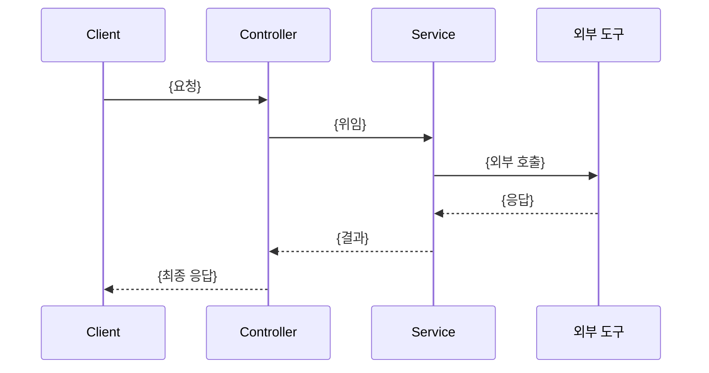

<!--
Flow 규칙:
- 파일명: `docs/flows/{kebab-case-기능명}.md`
- 시퀀스 다이어그램 필수 (참여자는 실제 클래스명 표기)
- 예외 표는 실제 발생 건만, 결정 이유는 본문 대신 ADR 링크로 연결
-->

# {기능/플로우 이름}

## 개요

{1~2문장. 이 플로우가 무엇을 달성하는지. 진입점(엔드포인트/트리거)을 명시.}

## 시퀀스

## 단계

1. **{단계}** — {설명}
2. **{단계}** — {설명}

## 예외

| 상황 | 처리 |
|---|---|
| {상황} | {응답 코드와 동작} |

## 관련 문서

- ADR: {되돌리기 힘든 결정이 있으면 링크}
- CONTEXT: {새 용어가 있으면 링크}
